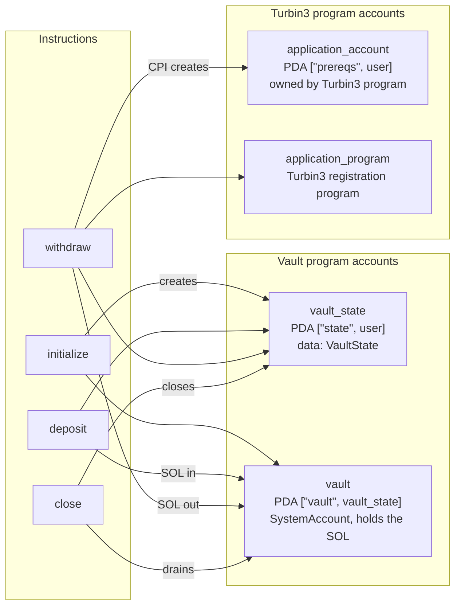
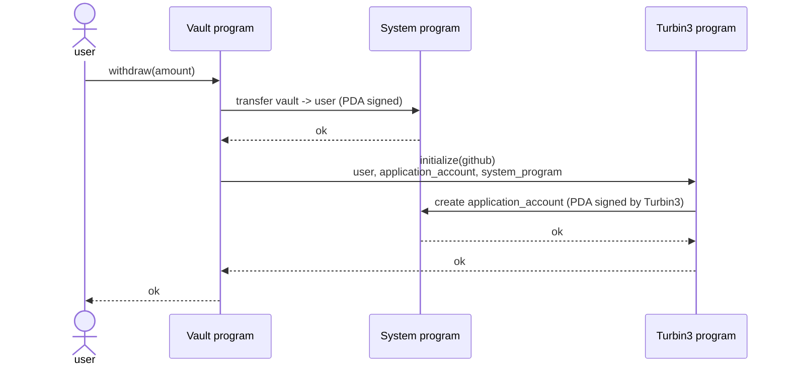

# Pre-req Vault: Architecture

An Anchor program that lets a user deposit SOL into a personal vault and withdraw it. The
`withdraw` instruction also makes a CPI into the Turbin3 registration program to create the
user's application account.

- Vault program (devnet): `FGKBGz1cWEVrdnksLAC6RP8ppCU1tzxcZkuVzF3TC1Fi`
- Turbin3 registration program: `TRBZyQHB3m68FGeVsqTK39Wm4xejadjVhP5MAZaKWDM`

## Accounts

All state is per user. The diagram shows each account, its PDA derivation, and which
instructions use it. `user` (signer, payer) and `system_program` are passed to every
instruction and are omitted from the edges to keep the picture readable.



| Account | Type | Derivation | Used by |
|---|---|---|---|
| `user` | Signer | wallet | all |
| `vault_state` | PDA, `VaultState` data | `["state", user]` under vault program | all |
| `vault` | PDA, system account, no data | `["vault", vault_state]` under vault program | all |
| `application_account` | PDA, `ApplicationAccount` data | `["prereqs", user]` under Turbin3 program | withdraw |
| `application_program` | Program | Turbin3 registration program | withdraw |
| `system_program` | Program | `11111111111111111111111111111111` | all |

## Instructions

The flow is linear: `initialize` once, then any number of `deposit` / `withdraw`, then `close`.

- **`initialize`**: creates `vault_state` and records the PDA bumps for later use.
- **`deposit(amount)`**: transfers `amount` lamports from `user` to `vault`.
- **`withdraw(amount)`**: transfers `amount` lamports from `vault` to `user`, signed with the
  vault PDA seeds. Then CPIs into the Turbin3 program to create `application_account` with
  the user's GitHub handle (see below).
- **`close`**: drains `vault` to `user` and closes `vault_state`, returning its rent.

## Registration CPI

The CPI sits at the end of `withdraw`, after the SOL transfer. `user` is already a signer on
the outer instruction, so no extra signing is needed; the Turbin3 program signs for its own
`prereqs` PDA when it creates the account.



Code: `programs/pre-req-vault/src/instructions/withdraw.rs`

```rust
let cpi_accounts = Initialize {
    user: self.user.to_account_info(),
    account: self.application_account.to_account_info(),
    system_program: self.system_program.to_account_info(),
};
let cpi_ctx = CpiContext::new(self.application_program.key(), cpi_accounts);
initialize(cpi_ctx, GITHUB_ID.to_string())?;
```

- `declare_program!(registration)` reads `idls/registration.json` and generates the
  `initialize` CPI function, its `Initialize` accounts struct, and the program type used to
  validate `application_program`.
- `application_account` is an `UncheckedAccount` with `seeds::program = application_program.key()`,
  so Anchor verifies the PDA address but doesn't deserialize it (it doesn't exist yet).
- `GITHUB_ID` is a `#[constant]` in `src/constants.rs`.
- The Turbin3 `initialize` is an `init`, so it succeeds once per wallet. Later `withdraw`
  calls from the same wallet will fail; use the Turbin3 `update` instruction to change the handle.
